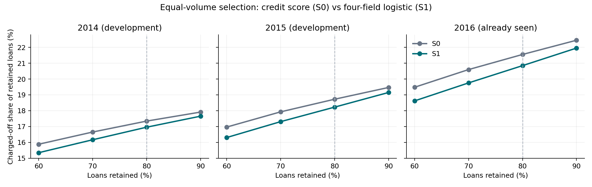

# Lending Club 信贷风险筛选策略离线评估

**业务问题：同样保留约80%的贷款，四字段逻辑回归比仅按信用分筛选，能否留下核销比例更低的人群？**

基于[Zenodo公开数据](https://zenodo.org/records/11295916)的 **1,347,681笔、15字段** 整理版贷款；Default按发布者定义为1=最终核销、0=全部结清。按批准年份切分：2007—2015训练，2016已查看补充评价，2017—2018封存、未作效果评价。2014/2015采用只用此前年份训练的滚动开发窗口。详见[方法与SQL口径](docs/方法与SQL复现.md)。

- **S0**：信用分越高越优先保留。
- **S1**：FICO、用途、就业年限、住房状态四字段逻辑回归。
- **S2**：S1加收入，用于检验增量；模型参数固定，无调参或特征搜索。

在每年共同贷款集合上，三策略均保留 `K=80*N//100` 笔。下表为候选减参照的保留人群核销比例差，单位**百分点**；负值代表候选更低。95%区间来自每年2,000次贷款配对bootstrap，每次重新等量筛选。

| 评价年 | 样本数 | 保留数 | S1−S0 [95%区间] | S2−S1 [95%区间] |
|---|---:|---:|---:|---:|
| 2014（开发） | 223,102 | 178,481 | −0.386 [−0.478, −0.305] | −0.071 [−0.140, −0.003] |
| 2015（开发） | 375,543 | 300,434 | −0.500 [−0.570, −0.428] | +0.069 [+0.020, +0.119] |
| 2016（已查看补充） | 293,057 | 234,445 | −0.706 [−0.794, −0.621] | −0.073 [−0.128, −0.017] |

[完整区间与精确数字](results/reference/bootstrap_intervals.csv) · [策略指标](results/reference/primary_metrics.csv) · [SQL交换分析](results/reference/sql/08_strategy_cross.csv)



图中四个点对应已有60%/70%/80%/90%情景，连线仅辅助阅读。[绘图代码](src/plot_tradeoff.py)直接读取已有结果，不重训。

**结论：S1作为后续验证候选；S2的开发期增量方向不一致，因此不采用。** 2015年S1在等量保留下少包含1,501笔核销贷款，属于离线样本比较，不能解释为上线避免的损失。

**局限：没有合格独立验证，2016已查看；仅含已放款且已终结贷款；缺可靠借款人标识、结果日期和统一快照，无法重建历史标签可用性。** 区间不覆盖开发选择偏差、训练不确定性、成熟度与未来环境变化，未控制借款人聚类；不是上线收益或因果估计。

## 查看材料

[六页项目展示](docs/六页项目展示.pdf) · [一页策略评审摘要](docs/策略评审摘要.pdf) · [15字段审核](docs/字段审核表.csv) · [监控与处置方案](docs/监控与处置方案.md) · [10项指标字典](docs/监控指标字典.csv)

`src/` 为固定核心流程，`sql/` 为9份查询及schema（SQLite，未验证MySQL），`audit/` 用于历史结果对账；[文件清单](docs/文件筛选清单.md)和[来源哈希](docs/source_provenance.json)记录整理过程。PDF为原最终交付展示快照，当前可执行命令以本README为准。

## 复现

Python 3.13，建议至少4GB可用内存和2GB磁盘。下载[原始CSV](https://zenodo.org/api/records/11295916/files/LC_loans_granting_model_dataset.csv/content)放入 `data/raw/LC_loans_granting_model_dataset.csv`；[数据说明](data/README.md)含哈希与下载来源。不要用Excel另存原文件。

```bash
python3 -m venv .venv
source .venv/bin/activate
python -m pip install -r requirements.txt
python src/run.py --data data/raw/LC_loans_granting_model_dataset.csv --output outputs/reproduction
python audit/verify.py --run outputs/reproduction
```

输出目录必须不存在。流程从CSV重建固定三年窗口S1/S2，执行6,000次配对bootstrap和9份SQL，不依赖旧项目、MySQL账号或历史模型。SQL01/02读取仓库附带的99行已发布上游状态汇总，其完整状态无法从已终结贷款CSV还原。模型、逐笔结果及SQLite数据库仅在已忽略的 `outputs/` 本地生成。

验收要求：历史整数与NULL位置一致，浮点绝对误差≤1e−12；检查报告为 `outputs/reproduction/verification.json`。实测环境、耗时及对账记录见[复现验收](docs/复现验收.md)。
